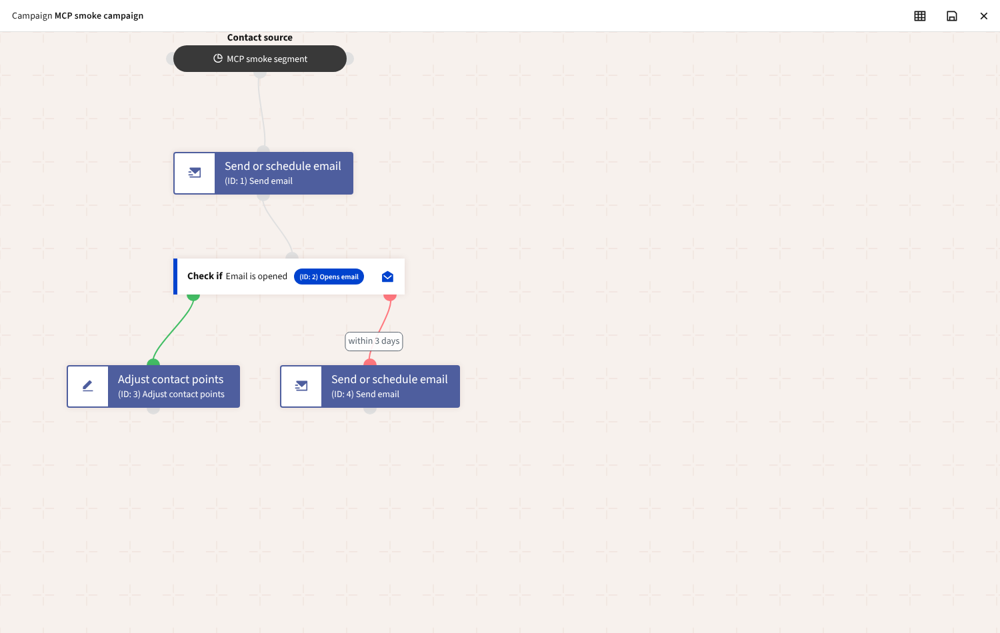
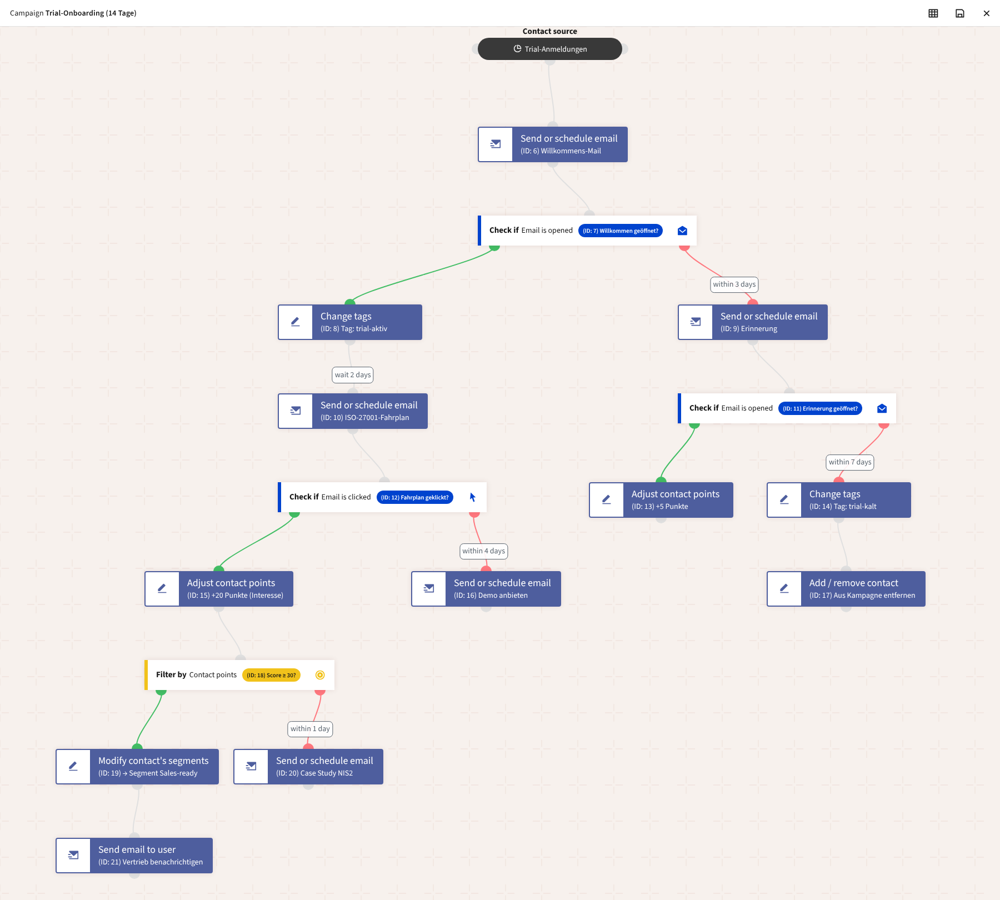
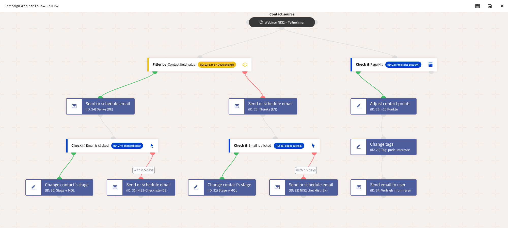

# MCP: Mautic for Claude, ChatGPT and other AI assistants

[`kopexa/mautic-mcp-bundle`](https://github.com/kopexa-grc/mautic-mcp-bundle) runs a
[Model Context Protocol](https://modelcontextprotocol.io) server inside
Mautic at `https://<mautic>/mcp`. It is built on the official
[MCP PHP SDK](https://github.com/modelcontextprotocol/php-sdk) and uses
Streamable HTTP. Clients sign in with OAuth 2.1 against Mautic itself
([docs/oauth.md](oauth.md)): a person logs in to Mautic, approves the
client and from then on the assistant works **with that person's Mautic
permissions**.

> **What an assistant can set in motion.** MCP never publishes,
> unpublishes or sends anything itself. Emails and new campaigns are
> created unpublished. **Two things are live:** editing a running
> (published) campaign, and adding contacts to segments that running
> campaigns or published segment emails use. Mautic's regular scheduler executes changed and
> added steps for the contacts in the campaign. That can send emails, for
> example a newly added reminder or a step switched to another email. See
> [What MCP changes can trigger](#what-mcp-changes-can-trigger).

## Enable

```yaml
mautic:
  siteUrl: https://mautic.example.com
  oauth:
    enabled: true     # authorization server; the MCP endpoint needs it
```

The endpoint must be reachable from the internet over HTTPS (ingress or
Gateway API). Claude and ChatGPT connect from their own servers, not from
your browser.

## Connect

| Client | How |
|---|---|
| **Claude** (claude.ai, Desktop, mobile) | *Settings → Connectors → Add custom connector*, URL `https://mautic.example.com/mcp`. Claude registers itself, opens the Mautic login and the consent page. |
| **ChatGPT** | *Settings → Apps & Connectors → Create* (developer mode), MCP server URL `https://mautic.example.com/mcp`, authentication *OAuth*. |
| **Claude Code** | `claude mcp add --transport http mautic https://mautic.example.com/mcp`, then `/mcp` to sign in. |
| **MCP Inspector** | `npx @modelcontextprotocol/inspector`, transport *Streamable HTTP*, URL as above. |

Discovery is automatic. The first request without a token gets `401` with
`WWW-Authenticate: Bearer resource_metadata=".../.well-known/oauth-protected-resource/mcp"` ([RFC 9728](https://www.rfc-editor.org/rfc/rfc9728)).
That document points to the authorization server metadata, and the client
registers dynamically. Nothing has to be configured in Mautic per client.

## Tools

| Tool | Scope | What it does |
|---|---|---|
| `search_contacts` | `mcp:read` | Search by name, email, company or Mautic search syntax (`tag:…`, `segment:…`); `includeFields` returns all profile fields (exports) |
| `list_contact_fields` | `mcp:read` | Contact fields: alias, label, type, choices, which ones identify contacts |
| `upsert_contacts` | `mcp:contacts:write` | Create or update up to 100 contacts per call, matched by email (and other unique fields): fields, tags (`-tag` removes), optionally into segments; `overwrite: false` fills only empty fields; `dryRun` |
| `create_segment` | `mcp:contacts:write` | New static segment (no filters) |
| `add_contacts_to_segment`, `remove_contacts_from_segment` | `mcp:contacts:write` | Change membership of up to 100 contacts; `dryRun`. **Adding can be live** (see below) |
| `get_contact` | `mcp:read` | Profile fields, tags, segments, points, stage, Do-Not-Contact status |
| `list_segments` | `mcp:read` | Segments with contact counts |
| `list_emails`, `get_email` | `mcp:read` | Emails with type, status, statistics, HTML |
| `get_email_stats` | `mcp:read` | Sent, read, read rate, clicks per link, pending recipients |
| `list_campaigns`, `get_campaign` | `mcp:read` | Campaigns with segments and their flow (in the `set_campaign_steps` format, with contacts per step) |
| `create_email_draft` | `mcp:write` | New **unpublished** email (HTML, subject, preheader, segments) |
| `update_email_draft` | `mcp:write` | Change an unpublished, never-sent email (published or sent emails are refused) |
| `list_campaign_step_types` | `mcp:read` | Available actions, decisions and conditions (including those of installed plugins) |
| `describe_campaign_step_type` | `mcp:read` | Properties of a step type (names, required, choices), which steps it may follow |
| `create_campaign_draft` | `mcp:write` | New **unpublished** campaign with segment source |
| `update_campaign_draft` | `mcp:write` | Change name, description, segments of an unpublished campaign |
| `set_campaign_steps` | `mcp:write` | Set the complete flow: actions, decisions, conditions, waits, yes/no branches (applied as a diff). **Live in running campaigns.** |
| `update_campaign_step` | `mcp:write` | Change one step (name, wait, properties). **Live in running campaigns.** |
| `add_campaign_step` | `mcp:write` | Add one step. **Live in running campaigns.** |
| `remove_campaign_step` | `mcp:write` | Remove one step; in a running campaign only after `dryRun` + `confirm`, optionally redirecting waiting contacts |

### Campaign flows

`set_campaign_steps` takes the flow as a list of steps. Each step has a
`key`, a `type` and optionally a `parent` (the step it follows), a `path`
(`yes`/`no` after a decision or condition), a `wait` and the type's
`properties`:

```json
[
  {"key": "welcome",  "type": "email.send", "properties": {"email": 12, "email_type": "marketing"}},
  {"key": "opened",   "type": "email.open", "parent": "welcome"},
  {"key": "engaged",  "type": "lead.changepoints", "parent": "opened", "path": "yes", "properties": {"points": 10}},
  {"key": "reminder", "type": "email.send", "parent": "opened", "path": "no",
   "wait": {"interval": 3, "unit": "d"}, "properties": {"email": 13, "email_type": "marketing"}}
]
```

The result opens in Mautic's campaign builder like a hand-built campaign:



Steps are validated the way the builder validates them:

- **Properties** go through the step type's own form, as in the builder
  modal. Required fields, allowed choices and plugin step types are checked
  the same way.
- **Connection rules:**
  - no decision directly after a decision
  - type restrictions such as `email.open` only after `email.send`
  - the `no` path of a decision needs a `wait` (how long the contact has to act)
- **Emails:** campaigns can only send template emails, and the user must be
  allowed to see them.
- **All or nothing:** an invalid flow changes nothing. A valid one is
  saved in one transaction.

### Realistic examples

Both flows below were built only through the MCP tools, the way an
assistant does it:

1. `list_campaign_step_types` and `describe_campaign_step_type` to find the
   steps and their settings.
2. `create_email_draft` for the emails.
3. `create_campaign_draft`.
4. `set_campaign_steps`, first with `dryRun`.

The screenshots are the unchanged Mautic campaign builder. Both scenarios
run on every image build (`test/mcp-scenarios.sh`). Mautic also executes
them there.

**Trial onboarding (16 steps).**

- Welcome email, then "opened?":
  - **yes:** tag `trial-aktiv`, then after 2 days the ISO 27001 roadmap,
    then "clicked?":
    - yes: +20 points, then a points condition (score ≥ 30?):
      - yes: move to the *Sales-ready* segment and notify sales
      - no: case study after 1 day
    - no: demo offer after 4 days
  - **no** (within 3 days): reminder, then "opened?":
    - yes: +5 points
    - no (within 7 days): tag `trial-kalt` and remove from the campaign



The test publishes the campaign (a person's step) and adds a trial user.
Mautic sends the welcome email. The test then opens it through Mautic's
real tracking pixel, and the contact takes the *yes* branch: tagged
`trial-aktiv`, roadmap email scheduled in 2 days.

**NIS2 webinar follow-up (13 steps, two entry points).**

- A field condition routes German contacts to German emails and everyone
  else to English ones.
- On both branches, a click moves the contact to the *MQL* stage. Without
  a click there is a checklist after 5 days.
- In parallel, a visit to the pricing page gives +15 points and a tag, and
  sales is notified.



The test adds a German and an Irish contact. Each receives only the email
of their language.

What these scenarios taught the tools, now handled for the assistant:

- **Tag fields take tag names.** Missing tags are created, as the builder's
  tag widget does while typing. `dryRun` lists them under `tags_to_create`.
- **Defaults the builder posts are filled in:** empty multi-selects and
  interval fields. Some Mautic step handlers rely on them, for example
  *Add / remove contact from campaign*.
- **Emails in `email.send.to.user` are checked too:** the user must be
  allowed to see them, and they must be template emails.

### Editing campaigns, including running ones

`get_campaign` returns the flow in exactly the format `set_campaign_steps`
accepts. The key of an existing step is its Mautic event ID, so the
assistant can read, change and send back without translating. Changes are
applied as a **diff**, the way Mautic's own API does:

| In the submitted flow | Effect |
|---|---|
| Key = existing step ID | Updated in place. The step keeps its ID, so contacts on their way and the statistics stay attached. Omitted `name`, `wait` and properties stay as they are. |
| New, non-numeric key | Step is added |
| Existing step left out | Step is removed |

For small edits there are single-step tools: `update_campaign_step`,
`add_campaign_step` and `remove_campaign_step`. Each reports what was
added, changed, removed and left unchanged. With `dryRun: true` it only
reports and saves nothing.

**Running (published) campaigns** can be edited too, with safeguards for
the contacts already in the flow:

| Change | Running campaign |
|---|---|
| Name, wait, properties of a step (e.g. 3 → 5 days, other email) | allowed. Contacts already scheduled on the step keep their time; the change applies to contacts reaching it from now on. |
| Add steps | allowed |
| Move steps (other parent or path) | refused. Contacts would suddenly be on a different branch. |
| Remove steps | only after a `dryRun`, which shows how many contacts are scheduled on the step, and with `confirm` / `allow_deletions`. `redirectTo` / `redirects` move waiting contacts to another step (Mautic's own redirect mechanism). Steps that have following steps cannot be removed one by one. |
| Change the type of a step | refused, also in drafts (remove it and add a new one) |

Publishing, unpublishing and sending stay with a person in Mautic. Every
change is written to the audit log with what was added, changed and
removed.

### What MCP changes can trigger

| Action | Effect |
|---|---|
| Create or change an email | Saved **unpublished**. Published or already sent emails cannot be changed. A person reviews and publishes it in Mautic (each result contains its `url`). Nothing is sent. |
| Create a campaign, edit a campaign that is not published | Draft only. No contact enters it and nothing runs until a person publishes it. |
| **Edit a running (published) campaign** | Only with the scope `mcp:campaigns:live` and if the instance allows it (see below). Then **live.** Mautic's scheduler (`mautic:campaigns:trigger`) executes added and changed steps for contacts reaching them. Email steps send to real recipients; webhook, push and similar steps reach external systems. Contacts already scheduled on a changed step keep their time but get the new content (for example, the email now set in the step). |
| Create or update contacts | Saved immediately. Mautic's own rules apply (unique email, field types). Do-Not-Contact (unsubscribed, bounced) is never changed, so an assistant cannot re-subscribe anyone. |
| **Add contacts to a segment** (`upsert_contacts` with `segmentIds`, `add_contacts_to_segment`) | **Can be live.** Running campaigns with this segment as source take the new members in with their next run; published segment emails of the segment are sent to them with the next broadcast run. The result lists both under `live_effects` (`running_campaigns`, `published_segment_emails`), also in a `dryRun`. New static segments from `create_segment` are used by nothing yet. |
| Publish, unpublish, send an email or campaign directly | Not possible via MCP. |

Safeguards for running campaigns:

- **Live effects in every result.** Each step tool returns `live_effects`
  when it touches a running campaign, also in a `dryRun`. It lists the
  outbound steps (email, message, webhook, push) that were added or changed
  and how many contacts are in the campaign.
- **Two technical locks.** Saving a change to a running campaign needs
  both of these. Otherwise the tool refuses; a dry run still works and
  shows `save_allowed: false` with the reason.

  | Lock | Set by | Default |
  |---|---|---|
  | `mautic.mcp.liveCampaignEdits` (env `MAUTIC_MCP_LIVE_CAMPAIGN_EDITS`) | Operator, for the whole instance | `true`. With `false`, running campaigns are read-only for MCP, whatever the token says. |
  | Scope `mcp:campaigns:live` | User, per connected client, on the consent page | **Not granted.** The scope is shown highlighted and unticked; the user has to tick it explicitly. |

- **Assistant instructions.** In addition, the server tells the assistant
  to dry-run first, show `live_effects` and save only after the user
  confirms. This is a convention, not a lock; the locks above are.
- **No moving steps; removing only with confirmation.** Steps cannot be
  moved. They can only be removed with `confirm` / `allow_deletions`, after
  a dry run shows the contacts waiting on them.
- **Permissions apply.** The user's Mautic role must allow editing the
  campaign (`campaign:campaigns:editown` / `editother`), and the token
  needs `mcp:write`.
- **Audit log.** Each change is recorded with the OAuth client id and
  what was added, changed and removed.

To keep assistants away from running campaigns entirely, set
`mautic.mcp.liveCampaignEdits: false`. Mautic's own role permissions cannot
express this: the edit permission covers published and unpublished
campaigns alike.

```yaml
mautic:
  oauth:
    enabled: true
  mcp:
    liveCampaignEdits: false   # running campaigns are read-only for MCP
```

### Syncing contacts with a CRM (e.g. Twenty)

With a CRM connector (such as Twenty's MCP server) and this one in the same
assistant, contacts move both ways without an import file:

- **CRM → Mautic:** *"Take all companies in Twenty with status Customer,
  their people with email, and put them into a new Mautic segment
  'Kunden 2026', tagged twenty."* The assistant calls `list_contact_fields`
  to map the fields, `create_segment`, then `upsert_contacts` in batches of
  100 with `dryRun` first (counts, rejected rows, `live_effects`) and saves
  after you confirm.
- **Mautic → CRM:** *"Export everyone in segment 'Webinar NIS2' who opened
  the follow-up, with company and position, to Twenty."*
  `search_contacts` with `segment:<alias>` and `includeFields: true`,
  paginated with `limit` / `offset`.

Existing contacts are found by email, so repeated syncs update instead of
duplicating (`unchanged` when nothing differs). `overwrite: false` keeps
values that are already set in Mautic.

## Permissions

Three layers, all of which must allow an action:

1. **Scopes** of the token, chosen by the user on the consent page:
   - `mcp:read`
   - `mcp:write` (email and campaign drafts, campaign flows)
   - `mcp:contacts:write` (contacts and segments)
   - `mcp:campaigns:live` (opt-in, needed for changes to running campaigns)

   A write call with a read-only token is answered with
   `403 insufficient_scope`.
2. **Mautic role** of the user who approved the client. The same
   own/other checks as the Mautic UI and API apply (`lead:leads:viewother`,
   `email:emails:create`, `email:emails:editown`, …). Users who may only see
   their own items only get those in lists.
3. **Bundle rules**: no publishing, unpublishing or direct sending.
   Emails can only be changed while unpublished and never sent. Running
   campaigns can be edited, live, within the rules
   [above](#what-mcp-changes-can-trigger).

We recommend a dedicated role, for example *AI Editor*:

- Emails: view, create, edit (own)
- Campaigns: view, create, edit (own). Edit also covers the role's own
  *running* campaigns, see above.
- Segments: view
- Contacts: view only if the assistant really needs contact data

Contact data is personal data. Before giving an assistant contact read
access, check your data processing agreement with the AI provider.

Each write is recorded in Mautic's audit log with the OAuth client id. A
disabled Mautic user loses access immediately, even with a valid token.

## Operations

- **Sessions** are kept in the Mautic database (table
  `kopexa_mcp_sessions`, created on first use). This works with several
  web replicas behind a load balancer and needs no sticky sessions.
- **Tokens** are verified offline against the instance's own signing key.
  No outbound connection is needed, so it works with
  `networkPolicy.egress.enabled`.
- **Host check:** requests must use the host of `siteUrl` (DNS rebinding
  protection). CORS is open, because browsers never send bearer tokens on
  their own.

## Tests

`test/smoke.sh` (section *MCP server*) runs on every image build:

- protected resource metadata
- 401 with `WWW-Authenticate`; forged tokens rejected
- initialize with a database session, `tools/list`
- search and contact details
- create and update a draft; a published email is refused
- `insufficient_scope` for a read-only token
- segments, campaign drafts and statistics
- a complete campaign flow (email → opened? → points / reminder after 3 days), the builder rules, and Mautic's campaign cron executing it
- editing the running campaign:
  - an unchanged round trip
  - wait 3 → 5 days with the step ID kept
  - adding a step
  - refused moves
  - removal only after dry run and confirmation, with the redirect stored in the database
  - the cron keeps running afterwards
- the locks:
  - `mcp:campaigns:live` is offered unticked and only granted when ticked
  - without it a running campaign is refused (dry run: `save_allowed: false`)
  - a second replica with `liveCampaignEdits=false` refuses even with the
    scope, reusing the same MCP session from the database
- the two realistic scenarios above (`test/mcp-scenarios.sh`), executed by
  Mautic including a real email open
- a restricted role that sees no contacts

`test/e2e-k3s.sh` checks discovery and the 401 challenge through the HTTPS
ingress.
