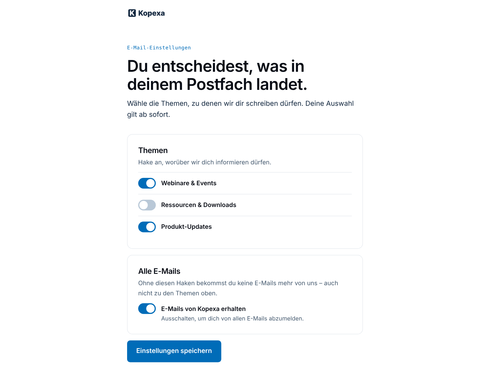

# Email preferences (preference center)

Recipients choose which emails they get instead of only unsubscribing from
everything. The link „Abmelden oder Themen wählen“ in the footer of every
Kopexa email opens a page in the Kopexa design (theme
`kopexa-preferences`) with

- **Themen** — one switch per topic (e.g. Webinare & Events, Ressourcen &
  Downloads, Produkt-Updates),
- **Alle E-Mails** — off unsubscribes from everything (*Do Not Contact*),
- one save button and a confirmation.



## How topics work

Topics are Mautic **categories** (bundle *global*). An email carries one
category; a contact who switched that topic off gets no email of that
category any more:

| Sent as | Topic switched off | All emails off |
|---|---|---|
| Campaign email (marketing) | not sent (logged in the campaign) | not sent |
| Segment email (newsletter) | not in the send list | not sent |
| Campaign email, *transactional*, without category | sent | not sent |

So:

- **Every marketing email gets its topic** (email → *Category*). Without a
  category the topic switches do not apply to it. The MCP email tools set it
  with `topic` (MCP bundle 0.8.0) and warn when an email has none.
- **Service emails** the person asked for (download link after a form,
  access link to a booked webinar, double opt-in) get **no** topic and are
  sent as *transactional* in the campaign step. They contain no marketing.
- *Alle E-Mails* off is final for all of them. Someone who later fills in a
  form again has to be re-subscribed (double opt-in).

Topics are not segments: a segment decides who is targeted, a topic
decides who does not want it. Mautic can also show segments on the page;
this setup does not, so nobody leaves a segment by accident.

## The plugin

Topics, the preference page and the webhooks come from
[kopexa/mautic-preferences-center](https://github.com/kopexa-grc/mautic-preferences-center),
a generic Mautic plugin (in the image, `image/plugins.txt`). It adds:

- per category *Show as topic*, *Position* and *Text for contacts*
  (Components → Categories → edit, section *Preference center*; also the
  categories API, field `preferencesCenter`);
- hidden topics keep each contact's choice when the page is saved (Mautic
  alone would switch every topic off that is not on the page);
- the webhook event *Contact email preferences changed*;
- `preferences-center:sync`, which the init container runs with the Helm
  values.

The design stays in the theme `kopexa-preferences` (this repository).

## Setup with the Helm chart

```yaml
mautic:
  preferenceCenter:
    topics:
      - name: Webinare & Events
        text: Einladungen und Erinnerungen zu Online-Terminen
      - name: Ressourcen & Downloads
        text: Neue Checklisten, Leitfäden und Vorlagen
      - name: Produkt-Updates
        text: Neue Funktionen und Verbesserungen in Kopexa
    hideOtherTopics: true   # other categories are not on the page
    # page: {alias: einstellungen, title: E-Mail-Einstellungen}   # the defaults
    # frequency: true    # also offer "fewer emails"
    # pauseDates: true   # also offer a pause
```

At every start the init container runs `preferences-center:sync` with these
values plus the image defaults (page `einstellungen` in the theme
`kopexa-preferences`, system pages in the theme `kopexa`):

1. topics: global categories matched by name, missing ones created; shown
   in the declared order with their text (`visible: false` hides one);
   `hideOtherTopics` hides every other category from the page. Nothing is
   deleted;
2. the preference page: created once from the theme, marked as preference
   center and published. After that it is edited in Mautic; set
   `page.updateContent: true` once to re-create its content from the theme
   (e.g. after a theme update — pages built with the builder keep their
   stored HTML);
3. Mautic's unsubscribe settings: show the preferences with the topics
   (not segments), the page as default preference center for all emails,
   the Kopexa theme for the system pages.

Nothing is written when everything matches (`unchanged` in the log).
Invalid values stop the init with a list of errors.

**Topics in Helm and in Mautic.** Settings changed in Mautic (text,
position, shown) are set back to the values at the next start for the
topics listed there. Keep a topic either in the values or in Mautic: topics
not listed are left as they are set in Mautic. Renaming a listed topic in
Mautic makes the next start create it again under its old name; rename it
in the values instead.

## Webhooks

Other systems (CRM, product, data warehouse) learn about changes through
Mautic's webhooks: *Settings → Webhooks → New*, event *Contact email
preferences changed*, the receiver's URL and a secret. One message per
contact with the changed topics or all-emails state, the source
(preference page, one-click unsubscribe, re-subscribe, admin, API) and the
current state; signed (`Webhook-Signature`, HMAC-SHA256 with the secret).
Format and verification: see the plugin's README.

A receiver in the cluster has a private address, which Mautic refuses
unless it is allowed:

```yaml
mautic:
  configParameters:
    webhook_allowed_private_addresses: [crm.internal.svc.cluster.local]
```

## Texts

Mautic's own texts on these pages are English unless a language pack is
installed. The Kopexa themes use their own German texts instead:

- email footer: „Abmelden oder Themen wählen“ (`{unsubscribe_url}`) and „Im
  Browser ansehen“ (`{webview_url}`), not Mautic's `{unsubscribe_text}` /
  `{webview_text}` (the theme QA rejects them);
- preference page: German labels wired to Mautic's form fields.

The confirmation after a one-click unsubscribe or a re-subscribe shows
Mautic's message (*Configuration → Email Settings → Unsubscribe message /
Resubscribe message*), in the Kopexa layout. Set German texts there, e.g.
„Du bist abgemeldet und bekommst keine E-Mails mehr von uns. Versehentlich?
\<a href="|URL|"\>Wieder anmelden\</a\>.“

## Fonts and privacy

Mautic's builders offer a list of fonts and load each one with a URL into
every page Mautic renders — by default eight Google Fonts, so every
visitor's IP address went to Google. The image replaces that list
(`editor_fonts`) with the Kopexa brand fonts, self-hosted by the theme
(`themes/kopexa/assets/fonts/kopexa-fonts.css`), and system fonts. Pages and
emails saved earlier still carried the Google links in their HTML; the
init removes those Mautic-injected links
(`kopexa:privacy:strip-third-party-fonts`). Override the list with
`mautic.configParameters.editor_fonts` if needed.

## Tests

`test/smoke.sh` (section *Email preference center*): the init sets up the
declared topics and page and changes nothing the second time; an email with
a topic is sent, its unsubscribe link opens the Kopexa page (one document,
no Google Fonts) with the topic texts and without the hidden topic;
switching one topic off is saved for that topic only, the hidden topic
stays on. The plugin's own functional tests cover the category form, the
API and the webhooks. The
landing page job of the theme QA (`qa/page.mjs`) checks the theme against
the brand rules and on screen widths from 320 to 1280 px.
