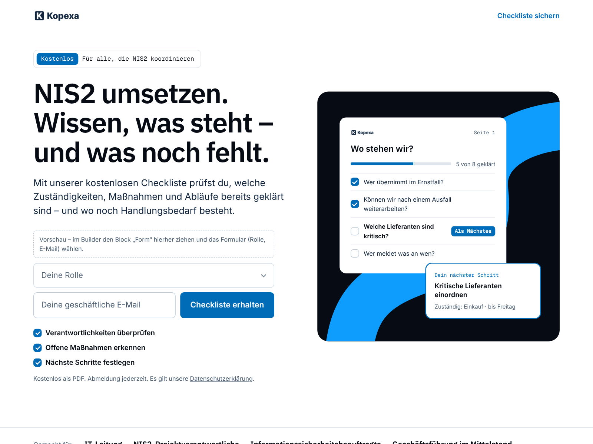

# Kopexa · Landing Page

Lead-gen landing page for Mautic in the Kopexa brand
([brand.kopexa.com](https://brand.kopexa.com)), set up for a free download
(example: a NIS2 checklist). White base, Navy brand surfaces with the open
route, Action Blue for actions. Mobile first.

Audience: the person who has just been asked to coordinate NIS2 — IT
leads, NIS2 project owners, information security officers; management in
mid-sized companies second. Not people who only want to learn about NIS2:
the copy speaks to implementing it, the form asks for the role.

Built for conversion:

- **One offer, two fields.** Role (select) and email next to the button
  (stacked on phones): the role qualifies the lead at almost no cost. Ask
  for name and company later with Mautic's progressive profiling.
- **Benefit before features.** Short headline, the outcome in plain
  language, no technical terms ("Nach einem Nachmittag weißt du es").
- **The offer is visible.** An art-directed preview of the checklist with
  progress and the next step, instead of a stock image.
- **Self-check.** Three questions to tick; the answer changes with the
  ticks (CSS only, no script) and leads to the download.
- **Outcomes bento**, the contents as plain questions, three answers to
  objections, one closing call to action. Every section has at most one
  primary action; the header has a single anchor link to the form.

Sections are independent: delete, duplicate or reorder them in the builder.

## Setting up the download

1. Upload the PDF as an **asset** (*Components → Assets*).
2. Create a **form** with a select *Rolle* (IT-Leitung, NIS2-Projekt-
   verantwortung / ISB, Geschäftsführung, Beratung, Andere; first option
   „Deine Rolle“ as placeholder, mapped to a contact field), the field
   *Email* (required; placeholder „Deine geschäftliche E-Mail“) and a
   submit button „Checkliste erhalten“.
   Action: *Download an asset* or *Send email to contact* with the asset
   link; post-submit message, e.g. „Danke! Die Checkliste ist unterwegs zu
   dir.“ Optional: progressive profiling for first name and company.
3. Create the landing page with this theme and drag the builder's *Form*
   block onto the dashed preview in the hero (it replaces the preview).
4. Funnel: checklist → follow-up on measures, evidence, risks and
   responsibilities → Kopexa demo. Score the download (point action
   *Downloads an asset*), weight the role (e.g. a dynamic segment on
   IT-Leitung / NIS2 owners) and start the follow-up campaign from it.

The texts are examples written to the brand's rules (informal *du*,
problem line above the solution, no promises, no invented figures or
customer quotes). The audience line names the target groups from
brand.kopexa.com; replace it with real customer logos once you may use
them.

Fonts and logo come from the base theme
([`mautic-theme-kopexa`](../mautic-theme-kopexa)); its `qa/page.mjs` checks
this theme (brand palette and contrast, radii, no shadows, links, copy
rules, no sideways scrolling from 320 to 1280 px, tap targets, one primary
action per section) and renders the thumbnail.
