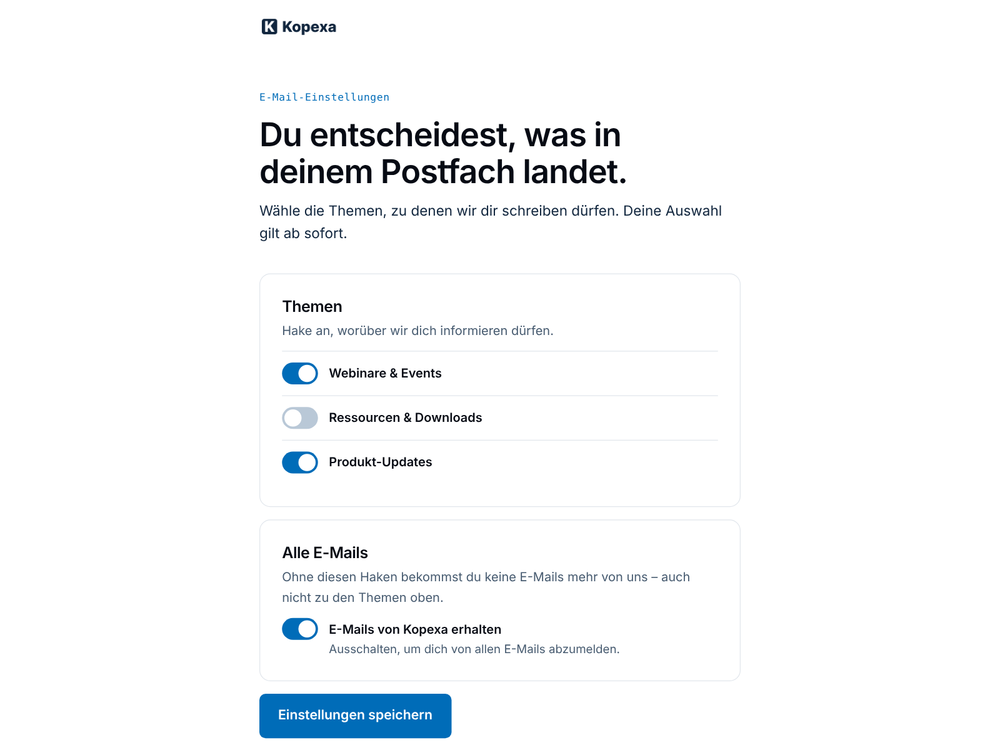

# Kopexa · E-Mail-Einstellungen

Preference center for Mautic in the Kopexa brand: the page a recipient
reaches through „Abmelden oder Themen wählen“ in every email. White base,
switches for the topics and for all emails, one save button, a
confirmation after saving. Mobile first.

## How it works

The template contains Mautic's preference center tokens
(`{categorylist}`, `{channelfrequency}`, `{saveprefsbutton}`,
`{successmessage}`). Mautic replaces them with its form fields and wraps a
form around them, so they stay inside `.kx-form`. Mautic's own labels are
English unless a language pack is installed; the theme hides them and adds
German texts wired to Mautic's fields (`<label for="email">`, the save
function `saveUnsubscribePreferences`). The system pages around it come
from the base theme (`html/message.html.twig`).

- **Topics** are Mautic categories (bundle *global*). A contact who switches
  a topic off gets no more emails of that category, neither from campaigns
  nor as segment emails. Every marketing email needs its category.
- **All emails** is Mautic's email channel: switched off, the contact is
  *Do Not Contact – unsubscribed*.

## Setup

1. Create the topics as global categories.
2. Create a landing page with this theme, mark it as *preference center*
   and publish it.
3. Configuration → Email Settings → unsubscribe settings: show contact
   preferences and categories, default preference center = that page.
   Configuration → Theme Settings: default theme *Kopexa*, so the system
   pages of emails without a theme look the same.

In the Kopexa Mautic image steps 1–3 come from the Helm values
(`mautic.preferenceCenter`).

The page only works when opened from an email link (Mautic needs to know
the contact). Pages built with GrapesJS store their HTML: after a theme
update, re-create the page or apply the template again in the builder.

Fonts and logo come from the base theme
([`mautic-theme-kopexa`](../mautic-theme-kopexa)); its `qa/page.mjs`
checks this theme (brand palette and contrast, radii, links, copy rules,
no sideways scrolling from 320 to 1280 px, tap targets).
