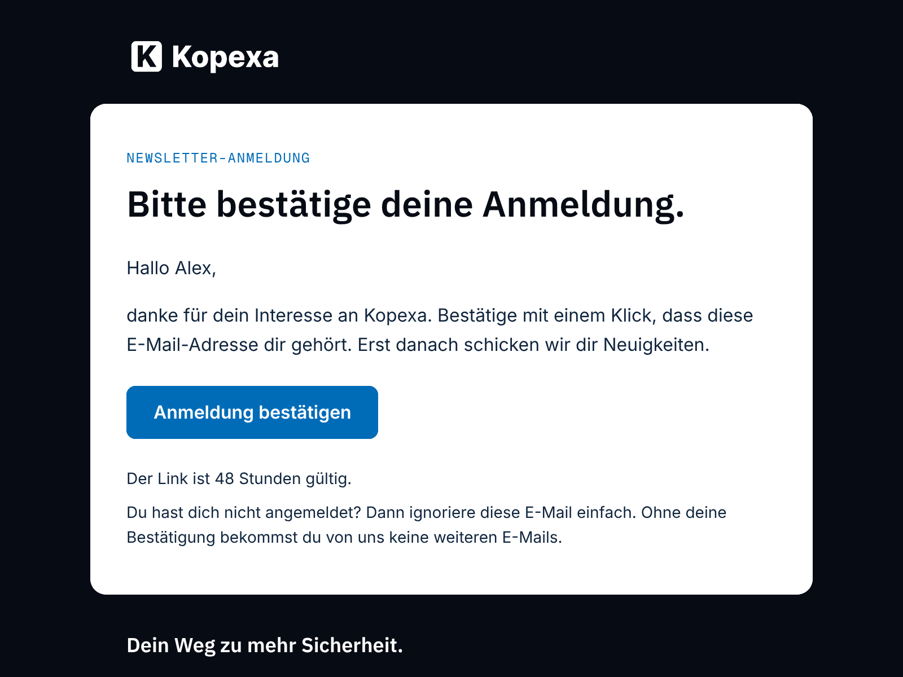
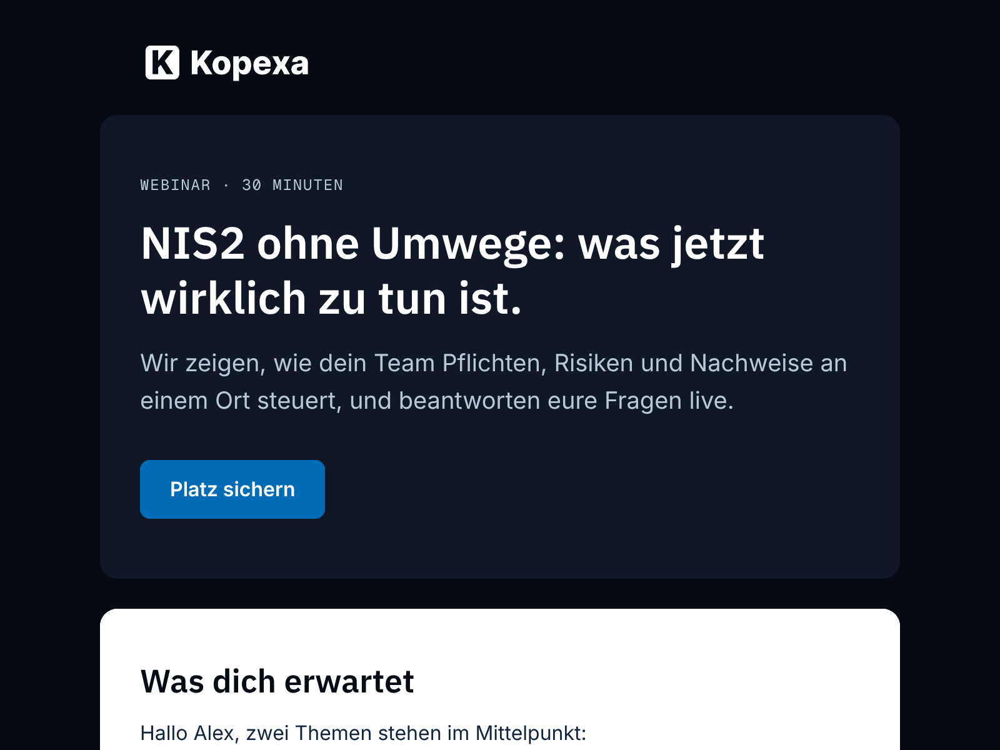

# Kopexa email theme for Mautic

MJML email theme for Mautic 7's GrapesJS builder, built from the design
tokens of [brand.kopexa.com](https://brand.kopexa.com) and shipped in the
kopexa Mautic image (`themes/kopexa`).

## Installation

Built into the Mautic image
[`ghcr.io/kopexa-grc/mautic`](https://github.com/kopexa-grc/mautic-stack).
Pick the theme *Kopexa* when creating an email in the builder. The theme
is Kopexa's own design and is not published as a separate package.


## Variants

A Mautic theme holds exactly one email template, so further layouts are
separate theme packages next to this one. They share head (fonts, tokens),
header and footer with this theme (`qa/check.mjs` fails if they drift) and
use its assets.

| Theme | Package | Use |
|---|---|---|
| *Kopexa* | this one | standard mail: label, headline, text, button |
| *Kopexa · Anmeldung bestätigen* | [`mautic-theme-kopexa-confirm`](../mautic-theme-kopexa-confirm) | double opt-in: button to `{doi_link}` of the Leuchtfeuer DOI plugin (see [docs/plugins.md](../../../docs/plugins.md#double-opt-in)) |
| *Kopexa · Hero + Split* | [`mautic-theme-kopexa-hero`](../mautic-theme-kopexa-hero) | hero on the dark surface, two cards with images, one full-width feature; delete what you don't need |

 

The images in *Hero + Split* (`assets/placeholder/`) are abstract
placeholders: replace them in the builder (*Image → Asset*) or delete them.
Card images are 272 × 153 px, the feature image 576 × 288 px (upload at
twice the size for sharp displays).

## Emails built by assistants

`mcp/blocks.json` is a block library for
[kopexa/mautic-mcp-bundle](https://github.com/kopexa-grc/mautic-mcp-bundle)
(`list_email_layouts`, `create_email_from_layout`): an assistant composes
an email from panels and their elements, the MCP server stores it as MJML
(editable in the builder) and as HTML (Mautic compiles MJML only in the
browser, the server needs the HTML to send).

| Panel | Areas and elements |
|---|---|
| `hero` | `items`: label, title, lead, button, image (dark surface) |
| `article` | `items`: label, title, subtitle, lead, text, note, button, button_secondary, image |
| `cards` | `intro`: subtitle, text; `left` / `right`: image, label, title, text, button |

Header and footer are added automatically, panels are separated by a navy
gap. `qa/blocks.mjs` generates the library from this theme's head, header,
footer and tokens; `node qa/blocks.mjs --check` (CI) fails if it is out of
date and proves that an assembled email is identical to what MJML compiles
from the assembled MJML. Change the theme, then run `node qa/blocks.mjs`.

## Builder rules

Mautic's GrapesJS builder imposes rules a template must follow, or emails
break after the first save:

- the root is exactly `<mjml>` (no attributes), otherwise *No valid MJML provided*;
- no self-closing tags (`<mj-image />`): the builder parses the template as HTML;
- every `mj-section`, `mj-text` and `mj-button` has an `mj-class`. When an
  email is reopened, the builder gives sections without one its default
  token `t-section t-surface-1` (white: header and footer turned white,
  logo and claim invisible) and drops inline attributes equal to MJML's
  defaults (e.g. `font-size="13px"`). Styles therefore live in `mj-class`es.

`qa/check.mjs` checks all of them.

## Design

| Token | Value | Use |
|---|---|---|
| Navy | `#070B14` | page background, header, footer |
| White | `#FFFFFF` | content panel (radius 14 px) |
| Text on white | `#10253D` | body text |
| Action Blue | `#006CB8` | buttons with white text, links, small labels (5.5:1) |
| Route Blue | `#0E9DFD` | accent only — never text or buttons on white |
| Supporting | `#B9C8D7` | secondary text on Navy |

Fonts: IBM Plex Sans 600 (headings), Inter 400/600 (text, buttons),
Geist Mono (labels) — served by Mautic itself (OFL), with system fallbacks.

The builder's token classes (`t-h1`…`t-h4`, `t-body`, `t-lead`, `t-btn`,
`t-btn-primary`, `t-btn-secondary`, `t-section`, `t-surface-1`) carry the
brand styles, so blocks dropped in the editor are on brand automatically.
Footer: claim, company address, imprint and privacy links, unsubscribe and
web-view tokens.

## Quality gate

Every change runs [`.github/workflows/theme.yml`](../../../.github/workflows/theme.yml):

| Check | Tool | Threshold |
|---|---|---|
| Valid MJML, compiled exactly like Mautic's builder | `mjml@4.15.3` (strict) | no errors |
| HTML size | `qa/check.mjs` | < 102 KB (Gmail clipping), warn > 60 KB |
| Images: alt text, https, width | `qa/check.mjs` | all |
| Links: https only, no URL shorteners | `qa/check.mjs` | all |
| Unsubscribe, imprint, privacy, `lang`, `<title>`, plain-text part | `qa/check.mjs` | present |
| Brand palette only; Route Blue never as text/button colour | `qa/check.mjs` | all |
| Contrast of every text/background pair | `qa/check.mjs` | WCAG AA 4.5:1 |
| No external stylesheets; fonts embedded | `qa/check.mjs` | none |
| Client compatibility (caniemail data) | Mailpit html-check | ≥ 80 % |
| External links reachable | Mailpit link-check | no errors |
| Spam score | rspamd via Mailpit | < 4 |
| Desktop / mobile screenshots | Playwright | artifact |

Every check runs per theme (CI: one job per theme). Run locally:

```bash
cd image/extensions/mautic-theme-kopexa/qa && npm ci
for t in .. ../../mautic-theme-kopexa-confirm ../../mautic-theme-kopexa-hero; do
  node render.mjs $t && node check.mjs $t && ./deliverability.sh $t && node screenshots.mjs $t
done
```

Sending-side deliverability (SPF, DKIM, DMARC alignment of the Postal
domain, RFC 8058 one-click unsubscribe headers) is a property of the
Postal/Mautic setup, not of the template — see #4.

Brand assets (logo, fonts) are taken unchanged from brand.kopexa.com;
fonts are licensed under the SIL Open Font License (`assets/fonts/*-OFL.txt`).
