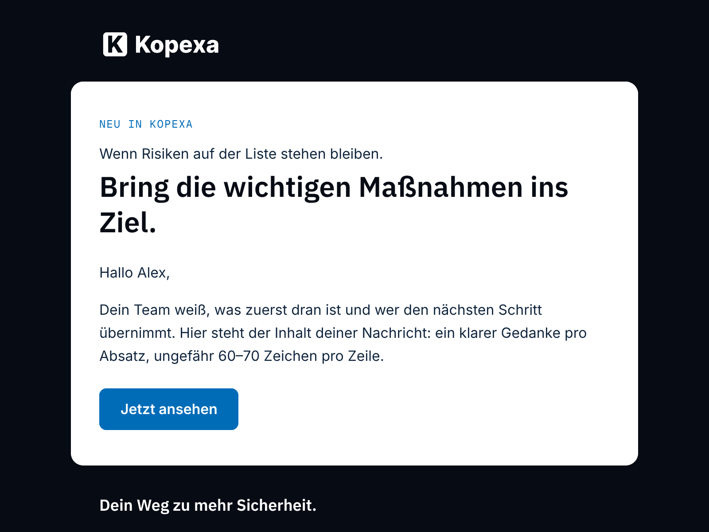

# Kopexa email theme for Mautic

MJML email theme for Mautic 7's GrapesJS builder, built from the design
tokens of [brand.kopexa.com](https://brand.kopexa.com) and shipped in the
kopexa Mautic image (`themes/kopexa`).

## Installation

Built into the Mautic image
[`ghcr.io/kopexa-grc/mautic`](https://github.com/kopexa-grc/mautic-stack).
Pick the theme *Kopexa* when creating an email in the builder. The theme
is Kopexa's own design and is not published as a separate package.



## Design

| Token | Value | Use |
|---|---|---|
| Navy | `#070B14` | page background, header, footer |
| White | `#FFFFFF` | content panel (radius 14 px) |
| Text on white | `#10253D` | body text |
| Action Blue | `#006CB8` | buttons with white text, links, small labels (5.5:1) |
| Route Blue | `#0E9DFD` | accent only — never text or buttons on white |
| Supporting | `#B9C8D7` | secondary text on Navy |

Fonts: IBM Plex Sans 600 (headings), Inter 400/600 (text, buttons),
Geist Mono (labels) — served by Mautic itself (OFL), with system fallbacks.

The builder's token classes (`t-h1`…`t-h4`, `t-body`, `t-lead`, `t-btn`,
`t-btn-primary`, `t-btn-secondary`, `t-section`, `t-surface-1`) carry the
brand styles, so blocks dropped in the editor are on brand automatically.
Footer: claim, company address, imprint and privacy links, unsubscribe and
web-view tokens.

## Quality gate

Every change runs [`.github/workflows/theme.yml`](../../../.github/workflows/theme.yml):

| Check | Tool | Threshold |
|---|---|---|
| Valid MJML, compiled exactly like Mautic's builder | `mjml@4.15.3` (strict) | no errors |
| HTML size | `qa/check.mjs` | < 102 KB (Gmail clipping), warn > 60 KB |
| Images: alt text, https, width | `qa/check.mjs` | all |
| Links: https only, no URL shorteners | `qa/check.mjs` | all |
| Unsubscribe, imprint, privacy, `lang`, `<title>`, plain-text part | `qa/check.mjs` | present |
| Brand palette only; Route Blue never as text/button colour | `qa/check.mjs` | all |
| Contrast of every text/background pair | `qa/check.mjs` | WCAG AA 4.5:1 |
| No external stylesheets; fonts embedded | `qa/check.mjs` | none |
| Client compatibility (caniemail data) | Mailpit html-check | ≥ 80 % |
| External links reachable | Mailpit link-check | no errors |
| Spam score | rspamd via Mailpit | < 4 |
| Desktop / mobile screenshots | Playwright | artifact |

Run locally:

```bash
cd image/extensions/mautic-theme-kopexa/qa && npm ci && node render.mjs && node check.mjs && ./deliverability.sh
```

Sending-side deliverability (SPF, DKIM, DMARC alignment of the Postal
domain, RFC 8058 one-click unsubscribe headers) is a property of the
Postal/Mautic setup, not of the template — see #4.

Brand assets (logo, fonts) are taken unchanged from brand.kopexa.com;
fonts are licensed under the SIL Open Font License (`assets/fonts/*-OFL.txt`).
